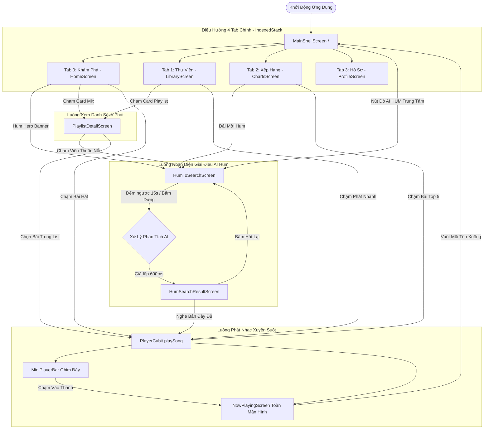

# Sonara - Ứng Dụng Âm Nhạc Trực Tuyến & Nhận Diện Giai Điệu AI (Frontend Documentation)

> **Tài liệu đặc tả kiến trúc, danh mục giao diện, luồng nghiệp vụ và ma trận chức năng của ứng dụng Sonara.**  
> *Phiên bản: 1.0.0 • Nền tảng: Flutter (Dart 3.x) • Quản lý trạng thái: BLoC / Cubit Pattern • Phong cách: Warm Ivory & Crimson Wine.*

---

## Mục Lục
1. [Tổng Quan Dự Án & Công Nghệ](#1-tổng-quan-dự-án--công-nghệ)
2. [Hướng Dẫn Khởi Chạy Nhanh (Getting Started)](#2-hướng-dẫn-khởi-chạy-nhanh-getting-started)
3. [Cấu Trúc Thư Mục & Phân Tầng Kiến Trúc](#3-cấu-trúc-thư-mục--phân-tầng-kiến-trúc)
4. [Bảng Thống Kê Toàn Bộ Giao Diện (Screens Catalog)](#4-bảng-thống-kê-toàn-bộ-giao-diện-screens-catalog)
5. [Mô Tả Chi Tiết Chức Năng Từng Giao Diện](#5-mô-tả-chi-tiết-chức-năng-từng-giao-diện)
6. [Bảng Ma Trận Tính Năng & Kế Hoạch Kiểm Thử (Test Plan)](#6-bảng-ma-trận-tính-năng--kế-hoạch-kiểm-thử-test-plan)
7. [Sơ Đồ Luồng Hoạt Động (User Flow)](#7-sơ-đồ-luồng-hoạt-động-user-flow)
8. [Phân Tích Kiến Trúc Dữ Liệu & State Management](#8-phân-tích-kiến-trúc-dữ-liệu--state-management)
9. [Báo Cáo Mức Độ Hoàn Thiện & Các Điểm Cần Nâng Cấp](#9-báo-cáo-mức-độ-hoàn-thiện--các-điểm-cần-nâng-cấp)
10. [Hướng Dẫn Tiếp Cận Mã Nguồn (Developer Onboarding)](#10-hướng-dẫn-tiếp-cận-mã-nguồn-developer-onboarding)

---

## 1. Tổng Quan Dự Án & Công Nghệ

**Sonara** (tên nội bộ package: `xmusic`) là ứng dụng nghe nhạc trực tuyến đa nền tảng (Mobile, Web, Desktop) được tích hợp công nghệ **AI Hum-to-Search** — nhận diện bài hát thông qua việc ngân nga hoặc huýt sáo giai điệu.

### 1.1. Công Nghệ Cốt Lõi
* **Framework:** [Flutter SDK](https://flutter.dev) (Dart SDK `^3.12.2`).
* **UI Design System:** Material Design 3 kết hợp phong cách tùy biến cao cấp:
  * **Chủ đạo:** Nền ấm **Warm Ivory** (`#FAF8F6`), màu nhận diện thương hiệu **Crimson Wine / Burgundy** (`#9A1B2F` - `#B3122E`).
  * **Gradient âm học AI:** `#B3122E` → `#FF4B4B`.
  * **Typography:** Phông chữ hiện đại **Plus Jakarta Sans** từ package `google_fonts: ^8.2.1`.
  * **Visualizer:** Đồ họa sóng âm động thời gian thực (Microphone Pulsing Rings, 19-Bar Soundwave, Mini Audio Wave).
* **Quản Lý Trạng Thái (State Management):** `flutter_bloc: ^9.1.1` với mô hình **Cubit Pattern** tinh gọn, đảm bảo tính bất biến (immutability) và phân tách UI hoàn toàn khỏi Business Logic.
* **Tầng Dữ Liệu Hiện Tại:** 100% Mock Services cục bộ chạy trên RAM, phục vụ việc kiểm thử trải nghiệm người dùng (UX) và kiểm tra tương tác UI trước khi ghép nối Backend API.

---

## 2. Hướng Dẫn Khởi Chạy Nhanh (Getting Started)

### 2.1. Yêu Cầu Môi Trường
* Cài đặt **Flutter SDK** (khuyến nghị phiên bản 3.24 trở lên, Dart 3.x).
* Trình duyệt Google Chrome (chạy Web) hoặc Visual Studio / C++ Desktop Development (chạy Windows Desktop), hoặc Android Emulator / iOS Simulator.

### 2.2. Các Lệnh Khởi Chạy
```bash
# 1. Di chuyển vào thư mục Frontend
cd Frontend

# 2. Cài đặt các gói phụ thuộc (Dependencies)
flutter pub get

# 3. Kiểm tra danh sách thiết bị khả dụng trên máy
flutter devices

# 4. Chạy ứng dụng trên Trình duyệt Web (Chrome)
flutter run -d chrome

# 5. Chạy ứng dụng trên Windows Desktop
flutter run -d windows

# 6. Chạy ứng dụng trên thiết bị di động (nếu có thiết bị kết nối)
flutter run
```

---

## 3. Cấu Trúc Thư Mục & Phân Tầng Kiến Trúc

Dự án áp dụng cấu trúc **Feature-First (Modular) kết hợp Clean Architecture** gồm 99 tệp Dart:

```text
lib/
├── main.dart                          # Entry point: Khởi tạo MultiBlocProvider toàn cục & MaterialApp
├── common/                            # Thành phần dùng chung toàn ứng dụng
│   ├── constants/
│   │   ├── app_colors.dart            # Hệ thống màu sắc (Warm Ivory, Crimson Wine, AI Gradients)
│   │   └── app_text_styles.dart       # Định nghĩa kiểu chữ, cỡ chữ, độ đậm theo Plus Jakarta Sans
│   ├── theme/
│   │   └── app_theme.dart             # ThemeData tùy biến chuẩn Material 3
│   └── widgets/
│       ├── app_network_image.dart     # Widget hiển thị ảnh mạng/asset thông minh có shimmer & fallback
│       ├── main_section_header.dart   # Header trang đồng nhất (Logo sóng âm + Title + Avatar)
│       └── pulsing_dot.dart           # Chấm tín hiệu nhấp nháy động (Live indicator)
├── core/                              # Thành phần cốt lõi hạ tầng
│   ├── routes/
│   │   └── app_router.dart            # Bộ điều hướng tập trung onGenerateRoute
│   └── utils/
│       └── formatters.dart            # Tiện ích định dạng thời lượng (mm:ss), số lượt nghe, tỷ lệ %
└── modules/                           # 8 Phân hệ tính năng (Feature Modules)
    ├── app/                           # Global Shell & Thanh điều hướng đáy (Bottom Nav + Mini Player)
    ├── home/                          # Phân hệ Khám Phá (Home Screen, Hero Banner, AI Mixes, Top Charts)
    ├── charts/                        # Phân hệ Bảng Xếp Hạng (VN 50, Global Viral, Spotlight Radar, Moods)
    ├── hum_to_search/                 # Phân hệ Nhận Diện Giai Điệu (Thu âm, Visualizer mic, Kết quả AI)
    ├── player/                        # Phân hệ Trình Phát Nhạc (Mini Player Bar, Now Playing toàn màn hình)
    ├── library/                       # Phân hệ Thư Viện (Bài hát đã thích, Lịch sử Hum, Playlist, Nghệ sĩ)
    ├── playlist/                      # Phân hệ Chi Tiết Danh Sách Phát (Mood AI Analysis, Tracklist)
    └── profile/                       # Phân hệ Hồ Sơ & Hiệu Ứng Âm Học (Spatial 3D, Stem Separation, EQ)
```

Mỗi module đều được chuẩn hóa thành 4 thư mục con:
* `bloc/`: Quản lý trạng thái và logic nghiệp vụ (`<feature>_cubit.dart` và `<feature>_state.dart`).
* `models/`: Chứa các data class định nghĩa cấu trúc dữ liệu bất biến.
* `presentations/`: Giao diện người dùng (`<feature>_screen.dart`) và thư mục `widgets/` chứa các thành phần nhỏ.
* `services/`: Cung cấp dữ liệu (`<feature>_mock_service.dart`).

---

## 4. Bảng Thống Kê Toàn Bộ Giao Diện (Screens Catalog)

Dự án có **chính xác 9 giao diện màn hình**, không có màn hình nào bị bỏ sót:

| STT | Tên Giao Diện | Route / URL | File Mã Nguồn | Phân Loại | Mục Đích Chính | Trạng Thái Kỹ Thuật |
| :---: | :--- | :--- | :--- | :---: | :--- | :---: |
| **1** | **Main Shell Layout** | `/` (Shell) | [main_shell_screen.dart](file:///e:/HOCKY7/PBL6/SORANA-CODE/Sonara/Frontend/lib/modules/app/presentations/main_shell_screen.dart) | **Layout Shell** | Khung bọc gốc chứa 4 tab chính dạng `IndexedStack`, gắn `MiniPlayerBar` và `MainBottomNavBar` nổi. | Hoàn thiện 100% UI & Navigation State |
| **2** | **Trang Khám Phá (Home)** | Tab 0 trong Shell | [home_screen.dart](file:///e:/HOCKY7/PBL6/SORANA-CODE/Sonara/Frontend/lib/modules/home/presentations/home_screen.dart) | **Page** | Cung cấp banner Hero AI Hum, danh sách AI Mixes, bài hát gợi ý theo gu và BXH xu hướng. | Hoàn thiện UI & BLoC (Mock Data) |
| **3** | **Thư Viện Cá Nhân (Library)** | Tab 1 trong Shell | [library_screen.dart](file:///e:/HOCKY7/PBL6/SORANA-CODE/Sonara/Frontend/lib/modules/library/presentations/library_screen.dart) | **Page** | Quản lý bài hát đã thích (ngoại tuyến), lịch sử Hum gần nhất, nghệ sĩ theo dõi, danh sách playlist. | Hoàn thiện UI & BLoC (Mock Data) |
| **4** | **Bảng Xếp Hạng (Charts)** | Tab 2 trong Shell | [charts_screen.dart](file:///e:/HOCKY7/PBL6/SORANA-CODE/Sonara/Frontend/lib/modules/charts/presentations/charts_screen.dart) | **Page** | Top 5 bài hát thịnh hành VN & Quốc Tế, Spotlight Radar tuần, lưới thể loại tâm trạng 2x2. | Hoàn thiện UI & BLoC (Mock Data) |
| **5** | **Hồ Sơ & Âm Học (Profile)** | Tab 3 trong Shell | [profile_screen.dart](file:///e:/HOCKY7/PBL6/SORANA-CODE/Sonara/Frontend/lib/modules/profile/presentations/profile_screen.dart) | **Page** | Thống kê số giờ nghe, kích hoạt 3D Spatial Audio, tách beat Karaoke, chỉnh độ nhạy mic và theme. | Hoàn thiện UI & BLoC (Mock Data) |
| **6** | **Thu Âm Nhận Diện (Hum Search)** | `/hum-to-search` | [hum_to_search_screen.dart](file:///e:/HOCKY7/PBL6/SORANA-CODE/Sonara/Frontend/lib/modules/hum_to_search/presentations/hum_to_search_screen.dart) | **Page (Modal Flow)** | Thu âm giọng ngân nga/huýt sáo: visualizer mic 19 thanh, vòng sóng lan tỏa, timer đếm 15s, xoay gợi ý. | Hoàn thiện UI & State mô phỏng |
| **7** | **Kết Quả Nhận Diện (Hum Result)** | `/hum-search-result` | [hum_search_result_screen.dart](file:///e:/HOCKY7/PBL6/SORANA-CODE/Sonara/Frontend/lib/modules/hum_to_search/presentations/hum_search_result_screen.dart) | **Page (Modal Flow)** | Hiển thị bài hát Best Match Top 1 (kèm snippet player nghe thử), các bài hát tiềm năng và nút hát lại. | Hoàn thiện UI & BLoC (Mock Data) |
| **8** | **Trình Phát Toàn Màn Hình (Now Playing)** | `/now-playing` | [now_playing_screen.dart](file:///e:/HOCKY7/PBL6/SORANA-CODE/Sonara/Frontend/lib/modules/player/presentations/now_playing_screen.dart) | **Page (Modal Screen)** | Trình phát nhạc chi tiết: ảnh bìa lớn, thanh kéo tua Scrubber, cụm điều khiển phát nhạc, Lyrics đồng bộ. | Hoàn thiện UI & BLoC mô phỏng |
| **9** | **Chi Tiết Playlist (Playlist Detail)** | `/playlist-detail` | [playlist_detail_screen.dart](file:///e:/HOCKY7/PBL6/SORANA-CODE/Sonara/Frontend/lib/modules/playlist/presentations/playlist_detail_screen.dart) | **Dynamic Page** | Chi tiết danh sách phát: Artwork lớn, Smart Shuffle, tải ngoại tuyến, phân tích AI Mood, danh sách track. | Hoàn thiện UI & BLoC (Mock Data) |

---

## 5. Mô Tả Chi Tiết Chức Năng Từng Giao Diện

### 5.1. Main Shell Screen
* **File:** `lib/modules/app/presentations/main_shell_screen.dart`
* **Mục đích:** Là giao diện khung bao bọc gốc, giữ trạng thái hoạt động của 4 tab qua `IndexedStack`.
* **Thành phần:**
  * `IndexedStack`: Chứa đồng thời `HomeScreen`, `LibraryScreen`, `ChartsScreen`, `ProfileScreen`.
  * `MiniPlayerBar`: Thanh phát nhạc thu nhỏ lơ lửng phía trên navbar, hiển thị tiến trình phát, tên bài hát, visualizer sóng âm mini 3 vạch và nút Play/Pause/Next.
  * `MainBottomNavBar`: Thanh điều hướng đáy 4 tab và nút tròn nổi trung tâm màu đỏ đô gradient `AI HUM`.
* **Tương tác:**
  * Chạm icon Tab -> `AppCubit.setTab(index)`.
  * Chạm nút `AI HUM` -> Mở `HumToSearchScreen`.
  * Chạm thanh `MiniPlayerBar` -> Mở `NowPlayingScreen` với hiệu ứng trượt từ dưới lên (`SlideTransition`).

### 5.2. Màn Hình Khám Phá (Home Screen)
* **File:** `lib/modules/home/presentations/home_screen.dart`
* **Thành phần & Tương tác:**
  * `HomeHeader`: Logo sóng âm, tiêu đề "Khám phá", avatar cá nhân (chạm để mở tab Profile).
  * `HumHeroBanner`: Khối banner nổi bật mời gọi ngân nga tìm nhạc, sóng âm động và nút "Thử tìm kiếm ngay" mở tính năng Hum Search.
  * `Mixes cho bạn`: Danh sách cuộn ngang các playlist AI tạo (Acoustic Tĩnh Lặng, Lo-Fi Giai Điệu Đêm, Indie Việt). Chạm để xem chi tiết hoặc bấm nút Play để phát ngay.
  * `Gợi ý cho bạn`: Danh sách bài hát khớp gu âm nhạc (98%, 95%, 91%). Bấm nút Trái tim để yêu thích (`HomeCubit.toggleFavorite`). Chạm vào bài hát để nạp vào `PlayerCubit` và mở `NowPlayingScreen`.
  * `TrendingChartCard`: Card BXH xu hướng có bộ gạt chuyển đổi **Theo Tuần** và **Theo Tháng** (`HomeCubit.setChartTimeframe`).

### 5.3. Màn Hình Thư Viện Cá Nhân (Library Screen)
* **File:** `lib/modules/library/presentations/library_screen.dart`
* **Thành phần & Tương tác:**
  * `LibraryFilterChips`: Thanh cuộn ngang lọc nhanh (Tất cả, Playlists, Bài hát đã thích, Lịch sử AI Hum, Nghệ sĩ).
  * `LikedSongsHeroCard`: Thẻ bài hát yêu thích màu đỏ đô (328 bài hát, ngoại tuyến). Bấm nút Play để phát ngẫu nhiên danh sách đã thích.
  * `AiHumHistoryCard`: Thẻ lịch sử ghi nhận 14 giai điệu đã tìm bằng AI Hum, hiển thị kết quả gần nhất ("Từng Quen - Vũ"). Bấm để nghe lại ngay.
  * `FollowingArtistsRow`: Cuộn ngang avatar các nghệ sĩ theo dõi (Vũ, Da LAB, Miu Lê, Hoàng Dũng, Sơn Tùng M-TP) kèm tích xanh chứng nhận.
  * `LibraryPlaylistTile`: Danh sách các playlist cá nhân kèm tag phân loại (AI Mood, Auto Mix, Cá nhân).
  * `StorageMetricTile`: Hiển thị dung lượng nhạc tải về máy (`4.2 GB • Chất lượng Studio Master`).

### 5.4. Màn Hình Bảng Xếp Hạng (Charts Screen)
* **File:** `lib/modules/charts/presentations/charts_screen.dart`
* **Thành phần & Tương tác:**
  * `ChartTabSwitcher`: Chuyển đổi giữa 2 bảng xếp hạng: **"Việt Nam Hot 50"** và **"Quốc Tế Viral"** (`ChartsCubit.switchTab`).
  * `ChartCategoryPills`: Lọc theo danh mục: Tổng hợp, Thịnh hành, Lossless Master, Podcast.
  * `SpotlightRadarCard`: Banner bài hát dẫn đầu xu hướng ngân nga tuần ("Khóa Ánh Mắt Lại" - Bùi Trường Linh, +48% Huýt sáo 24h).
  * `ChartRankTile`: Bảng xếp hạng Top 5 bài hát: Quán quân (Rank 01) nổi bật với viền đỏ sang trọng và huy hiệu `No.1`; các vị trí 02-05 hiển thị biến động tăng/giảm hạng và số lượt nghe. Chạm để phát nhạc.
  * `MoodGenreGrid`: Lưới 2x2 gồm 4 tâm trạng: Acoustic Mộc, Lo-Fi Làm Việc, V-Pop Thịnh Hành, EDM & Rap.
  * `HumQuickInviteCard`: Dải mời gọi tìm kiếm giai điệu ở cuối trang.

### 5.5. Màn Hình Thu Âm Nhận Diện (Hum-to-Search Screen)
* **File:** `lib/modules/hum_to_search/presentations/hum_to_search_screen.dart`
* **Thành phần & Tương tác:**
  * `AnimatedMicVisualizer`: Nút micro trung tâm phát sáng, 3 vòng sóng âm lan tỏa (Ripple rings) co giãn liên tục và bộ visualizer 19 cột phản hồi theo nhịp.
  * `TimerProgress`: Bộ đếm thời gian (`00:07 / 00:15`) và thanh tiến trình tuyến tính tự động chạy từ 0 đến 15 giây.
  * `HintRotatorCard`: Thẻ gợi ý xoay vòng tự động mỗi 3.8 giây (hát một câu, huýt sáo, ngâm nga la la la, giữ khoảng cách mic 15-20cm).
  * `ModeSegmentedSwitch`: Chuyển đổi 2 chế độ: **Huýt sáo (Whistle)** và **Ngân nga (Humming)**.
  * Nút "Dừng & Phân tích ngay": Dừng đếm giờ, hiển thị loading xoay vòng trong 600ms giả lập suy luận AI, sau đó tự động chuyển sang `HumSearchResultScreen`.

### 5.6. Màn Hình Kết Quả Nhận Diện (Hum Search Result Screen)
* **File:** `lib/modules/hum_to_search/presentations/hum_search_result_screen.dart`
* **Thành phần & Tương tác:**
  * Banner trạng thái: Thông báo "Đã tìm thấy 3 bài hát tương đồng • Khớp 96%" và nút "Hát lại" (thu âm lại từ đầu).
  * `BestMatchCard` (Top 1): Ảnh bìa bài hát khớp nhất ("Bầu Trời Mới - Da LAB ft. Miu Lê"), nhãn Lossless, tích hợp **Snippet Preview Player** nghe thử đoạn điệp khúc 15 giây, nút Trái tim, nút Thêm playlist và nút "Nghe bản đầy đủ" mở `NowPlayingScreen`.
  * `CandidateTrackCard`: Danh sách kết quả tiềm năng khác (độ khớp 84%, 78%).
  * `TroubleshootingCard`: Hướng dẫn mẹo khi tìm sai bài và tùy chọn tìm bằng lời bài hát.

### 5.7. Màn Hình Trình Phát Now Playing (Now Playing Screen)
* **File:** `lib/modules/player/presentations/now_playing_screen.dart`
* **Thành phần & Tương tác:**
  * Top bar: Nút mũi tên gập xuống đóng trình phát, hiển thị ngữ cảnh ("PHÁT TỪ GỢI Ý • AI Hum Match (98%)").
  * `AlbumArtworkHero`: Ảnh bìa album khổ lớn 300x300 bo góc cong 24px, tem chất lượng `Hi-Res Lossless 24-bit`.
  * Tên bài hát, nghệ sĩ, tem Explicit 'E', nút Thêm playlist và nút Trái tim yêu thích.
  * `PlaybackScrubber`: Thanh trượt thời gian kéo thả ngón tay (`onHorizontalDragUpdate`), hiển thị thời gian đã phát và thời gian còn lại.
  * `PlaybackControlsRow`: Bộ 5 nút điều khiển: Shuffle (Xáo trộn), Previous (Bài trước), Play/Pause lớn, Next (Bài tiếp theo), Repeat (Lặp lại).
  * `AcousticRouteChips`: Công tắc bật/tắt **Spatial Audio (Âm thanh vòm 3D)** và hiển thị thiết bị phát ("AirPods Pro").
  * `SyncedLyricsCard`: Khối hiển thị lời bài hát đồng bộ (Karaoke Lyrics), làm nổi bật dòng hiện tại và mờ các dòng khác.

### 5.8. Màn Hình Chi Tiết Playlist (Playlist Detail Screen)
* **File:** `lib/modules/playlist/presentations/playlist_detail_screen.dart`
* **Thành phần & Tương tác:**
  * `PlaylistHeroArtwork`: Ảnh đại diện vuông 300x300, tem `AI LIVE MIX` nhấp nháy và tem `Hi-Res 96kHz`.
  * `PlaylistMetaInfo`: Tiêu đề playlist ("Sonara AI Mix #01"), tag động cơ AI, mô tả tổng thời lượng.
  * `PlaylistActionControls`: Bộ nút Phát tất cả, Smart Shuffle, Tải ngoại tuyến, Yêu thích.
  * `PlaylistAiMoodCard`: Thẻ phân tích cảm xúc ("Trầm lắng & Hoài niệm") kèm 4 chip chọn phong cách nghe (Mặc định AI, Bình yên, Sôi động, Tập trung).
  * `PlaylistTrackTile`: Danh sách các bài hát trong playlist (từ track 01 đến 05). Chạm vào bất kỳ bài hát nào để mở `NowPlayingScreen`.
  * `PlaylistFloatingHumCapsule`: Viên thuốc nổi ở góc dưới cho phép kích hoạt tìm kiếm bằng giai điệu ngay khi đang duyệt playlist.

### 5.9. Màn Hình Hồ Sơ & Cài Đặt Âm Học (Profile Screen)
* **File:** `lib/modules/profile/presentations/profile_screen.dart`
* **Thành phần & Tương tác:**
  * `ProfileHeroCard`: Avatar, tên người dùng ("Lê Hải Đăng"), tích xanh, danh hiệu "VIP LOSSLESS" và 3 chỉ số thống kê (480 giờ nghe, 142 lần Hum, 68 playlist).
  * `AiAcousticEngineCard`:
    * Switch bật/tắt **Sonara Spatial 3D**.
    * Switch bật/tắt **AI Vocal & Beat Separation** (tách lời bài hát Karaoke).
    * Slider 3 nấc chỉnh độ nhạy micro AI Hum: Tiết kiệm, Tiêu chuẩn, Ultra Clean.
    * Thẻ thông tin chất lượng phát nhạc: "Hi-Res FLAC 24-bit / 192kHz • LOSSLESS".
  * `PreferencesListCard`:
    * Lịch sử nhận diện Hum (142 bản ghi).
    * Thiết bị đã ghép đôi ("AirPods Pro 2 • Hi-Fi LDAC").
    * Bộ cân bằng âm thanh Sonara EQ ("Acoustic Warmth").
    * Bộ 3 nút chuyển chế độ Theme: Sáng, Tối, Tự động.
  * Nút "Đăng xuất tài khoản" (hiện SnackBar thông báo) và footer thông tin phiên bản v1.0.0.

---

## 6. Bảng Ma Trận Tính Năng & Kế Hoạch Kiểm Thử (Test Plan)

Bảng tổng hợp dùng cho đội ngũ QA/Tester kiểm thử toàn diện chức năng giao diện:

| Mã Kiểm Thử | Giao Diện Liên Quan | Chức Năng Cần Kiểm Thử | Thao Tác Người Dùng | Hành Vi Kỳ Vọng Của Ứng Dụng | Trạng Thái Code |
| :---: | :--- | :--- | :--- | :--- | :---: |
| **TC-01** | `MainShellScreen` | Chuyển đổi 4 Tab đáy | Nhấn vào từng icon tab | Màn hình tương ứng hiển thị ngay, giữ vị trí cuộn | Sẵn sàng |
| **TC-02** | `MainShellScreen` | Nút trung tâm AI HUM | Chạm nút tròn đỏ giữa navbar | Mở `HumToSearchScreen` | Sẵn sàng |
| **TC-03** | `MiniPlayerBar` | Phóng to trình phát | Chạm vào thanh Mini Player | `NowPlayingScreen` trượt từ đáy màn hình lên | Sẵn sàng |
| **TC-04** | `MiniPlayerBar` | Phát / Dừng nhanh | Bấm icon Play/Pause trên Mini Bar | Icon chuyển đổi, sóng âm mini dừng/chạy | Sẵn sàng |
| **TC-05** | `HomeScreen` | Yêu thích bài hát gợi ý | Nhấn icon Trái tim bài hát | Icon đổi màu đỏ, cập nhật state `isFavorite` | Sẵn sàng |
| **TC-06** | `HomeScreen` | Đổi chu kỳ BXH xu hướng | Bấm toggle Tuần / Tháng | Nút active đổi trạng thái hoạt họa | Sẵn sàng |
| **TC-07** | `ChartsScreen` | Chuyển tab BXH Quốc gia | Bấm Tab "Việt Nam Hot 50" / "Quốc Tế Viral" | Danh sách bài hát Top 5 thay đổi tương ứng | Sẵn sàng |
| **TC-08** | `ChartsScreen` | Chọn danh mục xếp hạng | Chạm các category pill | Pill được chọn chuyển màu active | Sẵn sàng |
| **TC-09** | `HumToSearchScreen` | Tự động đếm giờ thu âm | Mở màn hình và chờ | Bộ đếm tăng từ 00:07 lên 00:15, thanh progress dài ra | Sẵn sàng |
| **TC-10** | `HumToSearchScreen` | Dừng & Phân tích ngay | Bấm nút "Dừng & Phân tích ngay" | Nút xoay loading 600ms, tự chuyển sang Result Screen | Sẵn sàng |
| **TC-11** | `HumToSearchScreen` | Xoay gợi ý ngân nga | Quan sát thẻ gợi ý | Văn bản gợi ý tự đổi sau mỗi 3.8 giây | Sẵn sàng |
| **TC-12** | `HumSearchResultScreen`| Nghe thử trích đoạn | Bấm Play trên Snippet của Top 1 | Đoạn nhạc nghe thử phát, icon đổi sang Pause | Sẵn sàng |
| **TC-13** | `HumSearchResultScreen`| Thu âm lại | Bấm nút "Hát lại" | Quay trở lại `HumToSearchScreen`, reset bộ đếm | Sẵn sàng |
| **TC-14** | `NowPlayingScreen` | Kéo tua Scrubber | Vuốt ngón tay dọc thanh tiến trình | Cập nhật thời gian đã phát và thời gian còn lại | Sẵn sàng |
| **TC-15** | `NowPlayingScreen` | Bật/tắt Spatial Audio | Chạm chip 3D Spatial | Nút đổi màu kích hoạt, state Cubit cập nhật | Sẵn sàng |
| **TC-16** | `NowPlayingScreen` | Chế độ Shuffle & Repeat | Chạm icon Xáo trộn và Lặp lại | Icon chuyển sang màu đỏ rực khi bật | Sẵn sàng |
| **TC-17** | `PlaylistDetailScreen` | Phát tất cả bài hát | Bấm nút Phát lớn ở thanh Action | Nạp track đầu tiên vào Player, Mini Bar hiển thị | Sẵn sàng |
| **TC-18** | `PlaylistDetailScreen` | Chọn tâm trạng AI Mood | Chạm vào các chip cảm xúc | Chip được chọn đổi màu nền nổi bật | Sẵn sàng |
| **TC-19** | `ProfileScreen` | Chỉnh độ nhạy mic AI Hum | Kéo Slider 3 nấc | Nhãn đổi: Tiết kiệm → Tiêu chuẩn → Ultra Clean | Sẵn sàng |
| **TC-20** | `ProfileScreen` | Chuyển chế độ Theme | Bấm nút Sáng / Tối / Tự động | Nút được chọn active (chưa đổi toàn bộ app) | Cần nâng cấp |

---

## 7. Sơ Đồ Luồng Hoạt Động (User Flow)



---

## 8. Phân Tích Kiến Trúc Dữ Liệu & State Management

### 8.1. State Management (BLoC / Cubit Pattern)
Ứng dụng sử dụng kiến trúc BLoC với 8 Cubit:
1. **Toàn cục (Global Singletons tại `main.dart`):**
   * `AppCubit`: Quản lý index tab đang chọn (`0`, `1`, `2`, `3`).
   * `HomeCubit`: Tải danh sách Mixes, Recommended Tracks, Trending Charts, toggle favorite.
   * `PlayerCubit`: Quản lý bài hát đang phát (`PlayingSongModel`), trạng thái play/pause, thời gian đã phát (`currentSeconds`), shuffle, repeat, spatial audio, lyrics.
   * `LibraryCubit`: Dữ liệu bài hát đã thích, lịch sử hum, danh sách playlist cá nhân, danh mục lọc.
   * `ChartsCubit`: Bảng xếp hạng VN Hot 50 vs Quốc tế, category selected.
   * `ProfileCubit`: Thông tin tài khoản người dùng và thiết lập âm học (Spatial, Vocal separation, độ nhạy mic).
2. **Cục bộ theo màn hình (Scoped Cubits):**
   * `HumSearchCubit`: Quản lý Timer đếm giây, xoay gợi ý, chế độ thu âm (Hum vs Ambient), kết quả phân tích AI và nghe thử snippet.
   * `PlaylistCubit`: Quản lý chi tiết danh sách phát theo `playlistId`, chọn AI Mood, smart shuffle, download.

### 8.2. Nguồn Dữ Liệu (Data Sources)
* **Số lượng HTTP/REST API thực tế: 0 Endpoint.** (Chưa có package `http` hay `dio` trong `pubspec.yaml`).
* Toàn bộ dữ liệu được cung cấp bởi **6 Mock Services**:
  * `HomeMockService`: Dữ liệu trang chủ.
  * `ChartsMockService`: Dữ liệu bảng xếp hạng & Spotlight radar.
  * `HumSearchService`: Dữ liệu kết quả nhận diện âm thanh.
  * `LibraryMockService`: Dữ liệu thư viện cá nhân.
  * `PlayerService`: Bài hát mặc định và lời bài hát đồng bộ.
  * `PlaylistMockService`: Chi tiết playlist tuyển chọn.
* **Lưu trữ:** Hiện tại lưu trữ 100% trong bộ nhớ RAM, chưa sử dụng `shared_preferences` hay SQLite.

---

## 9. Báo Cáo Mức Độ Hoàn Thiện & Các Điểm Cần Nâng Cấp

### 9.1. Điểm Mạnh
* Giao diện UI/UX cực kỳ đẹp mắt, chỉn chu, hiện đại, mang phong cách sang trọng với tông màu Warm Ivory & Crimson Wine.
* Hiệu ứng chuyển động mượt mà: Visualizer sóng âm 19 cột sống động, vòng tròn mic lan tỏa, mini wave bar nhấp nháy theo bài hát.
* Kiến trúc code sạch sẽ, phân tách module rõ ràng (Feature-First), State Management chuẩn mực, rất dễ dàng để cắm API thật vào thay thế Mock Services.

### 9.2. Các Hạn Chế Cần Nâng Cấp Kế Tiếp
1. **Tích hợp Native Audio Player:** Cần cài đặt package `just_audio` và `audio_session` để phát file âm thanh MP3/FLAC thật thay vì chỉ mô phỏng thời gian bằng biến số.
2. **Tích hợp Thu Âm Microphone Thật:** Cần cài đặt package `record` và `permission_handler` để ghi âm giọng nói người dùng và gửi file audio lên Backend AI Service.
3. **Kết nối Backend REST API:** Cài đặt package `dio` hoặc `http` để thay thế 6 Mock Services bằng các API endpoint từ máy chủ NodeJS/Express Backend.
4. **Lưu Trữ Bền Vững (Local Storage):** Cài đặt `shared_preferences` để lưu lại cấu hình người dùng (Theme sáng/tối, thiết lập âm thanh, trạng thái yêu thích bài hát).
5. **Hoàn thiện các luồng phụ:** Bổ sung màn hình Tìm kiếm văn bản, màn hình Đăng nhập/Đăng ký tài khoản, màn hình chi tiết Equalizer và trang Lịch sử nhận diện.

---

## 10. Hướng Dẫn Tiếp Cận Mã Nguồn (Developer Onboarding)

Để hiểu toàn bộ dự án nhanh nhất trong vòng 30 phút, lập trình viên mới nên đọc code theo thứ tự sau:

1. **Bước 1 - Điểm khởi chạy:** Đọc [lib/main.dart](file:///e:/HOCKY7/PBL6/SORANA-CODE/Sonara/Frontend/lib/main.dart) để nắm được các Cubit toàn cục và MaterialApp theme.
2. **Bước 2 - Bộ khung điều hướng:** Đọc [lib/modules/app/presentations/main_shell_screen.dart](file:///e:/HOCKY7/PBL6/SORANA-CODE/Sonara/Frontend/lib/modules/app/presentations/main_shell_screen.dart) và [main_bottom_nav_bar.dart](file:///e:/HOCKY7/PBL6/SORANA-CODE/Sonara/Frontend/lib/modules/app/presentations/widgets/main_bottom_nav_bar.dart) để hiểu cơ chế neo giữ 4 tab và Mini Player.
3. **Bước 3 - Trình phát nhạc:** Đọc [lib/modules/player/bloc/player_cubit.dart](file:///e:/HOCKY7/PBL6/SORANA-CODE/Sonara/Frontend/lib/modules/player/bloc/player_cubit.dart) và [now_playing_screen.dart](file:///e:/HOCKY7/PBL6/SORANA-CODE/Sonara/Frontend/lib/modules/player/presentations/now_playing_screen.dart).
4. **Bước 4 - Tính năng cốt lõi AI Hum:** Đọc [lib/modules/hum_to_search/bloc/hum_search_cubit.dart](file:///e:/HOCKY7/PBL6/SORANA-CODE/Sonara/Frontend/lib/modules/hum_to_search/bloc/hum_search_cubit.dart), [hum_to_search_screen.dart](file:///e:/HOCKY7/PBL6/SORANA-CODE/Sonara/Frontend/lib/modules/hum_to_search/presentations/hum_to_search_screen.dart) và [hum_search_result_screen.dart](file:///e:/HOCKY7/PBL6/SORANA-CODE/Sonara/Frontend/lib/modules/hum_to_search/presentations/hum_search_result_screen.dart).
5. **Bước 5 - Các trang nội dung:** Duyệt qua [home_screen.dart](file:///e:/HOCKY7/PBL6/SORANA-CODE/Sonara/Frontend/lib/modules/home/presentations/home_screen.dart), [charts_screen.dart](file:///e:/HOCKY7/PBL6/SORANA-CODE/Sonara/Frontend/lib/modules/charts/presentations/charts_screen.dart), [library_screen.dart](file:///e:/HOCKY7/PBL6/SORANA-CODE/Sonara/Frontend/lib/modules/library/presentations/library_screen.dart) và [profile_screen.dart](file:///e:/HOCKY7/PBL6/SORANA-CODE/Sonara/Frontend/lib/modules/profile/presentations/profile_screen.dart).
6. **Bước 6 - Định tuyến & Hệ thống Design:** Xem [lib/core/routes/app_router.dart](file:///e:/HOCKY7/PBL6/SORANA-CODE/Sonara/Frontend/lib/core/routes/app_router.dart) và [lib/common/constants/app_colors.dart](file:///e:/HOCKY7/PBL6/SORANA-CODE/Sonara/Frontend/lib/common/constants/app_colors.dart).
